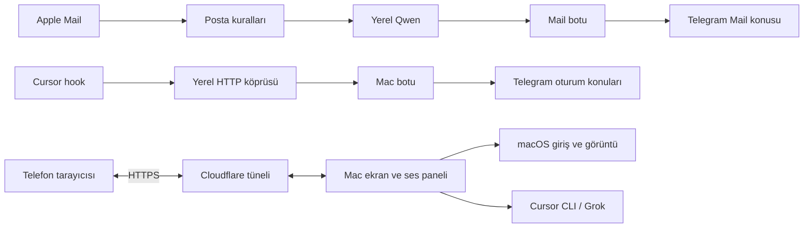

# Veri akışı

Botlar ayrı süreçlerdir. Sayısal grup ve konu kimlikleri bildirimlerin hedefini, kullanıcı listesi komutları kimin verebildiğini belirler. Masaüstü paneli ayrı bir oturum bağlantısıyla açılır. Cursor oturum izleri ve konu hafızası yerel `data/` dizinindedir.

## Geliştirme geçmişi

| Tarih | Projedeki çalışma |
| --- | --- |
| 17 Kasım 2026 | Apple Mail ve Qwen bildirimleri, Cursor oturumlarının Telegram konularına aktarılması. |
| 18 Kasım 2026 | Mobil ekran paneli, Türkçe sesli giriş ve uygulamalarda taslak yazma testleri. |
| 19 Kasım 2026 | İlk Git kaydı, kişisel yapılandırmanın ayrılması, taşınabilir kurulum ve macOS test iş akışı. |
