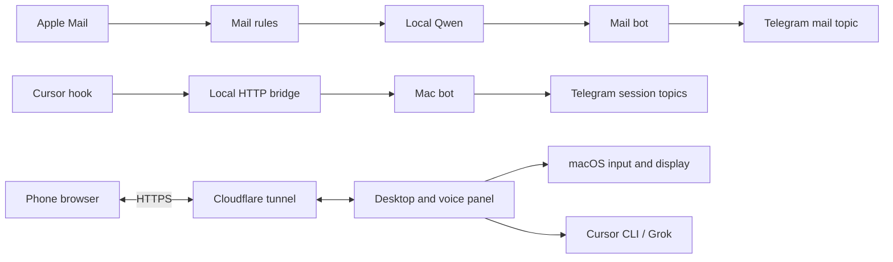

# Data flow

The two bots run as separate processes. Numeric group and topic IDs determine where notifications go. An allowlist controls who can issue Telegram commands. The desktop panel uses a separate per-session access link. Cursor traces and topic history are stored under `data/` on the Mac.

## Development history

| Date | Work |
| --- | --- |
| November 17, 2026 | Apple Mail notifications with Qwen and Cursor session mirroring to Telegram topics. |
| November 18, 2026 | Mobile screen panel, Turkish voice input, and tests for drafting messages in desktop apps. |
| November 19, 2026 | Initial Git history, separation of personal settings, portable setup, and macOS CI. |
